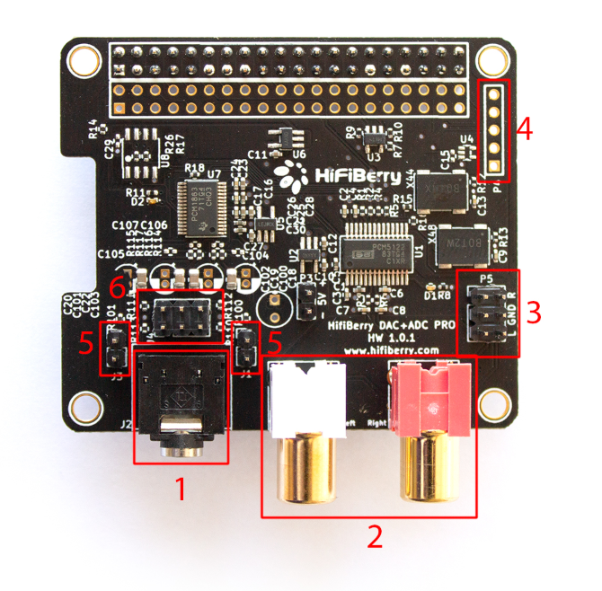
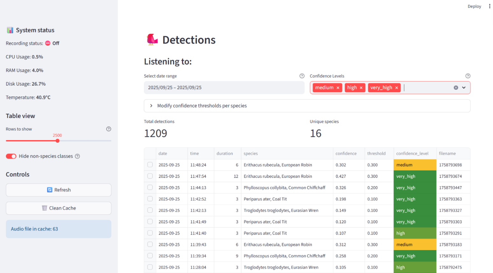
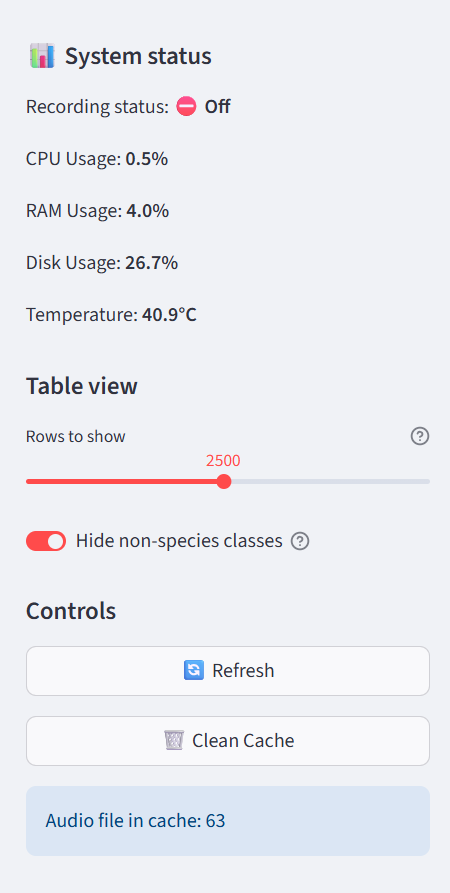
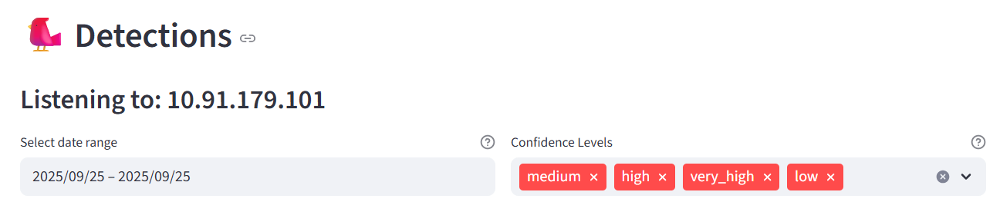
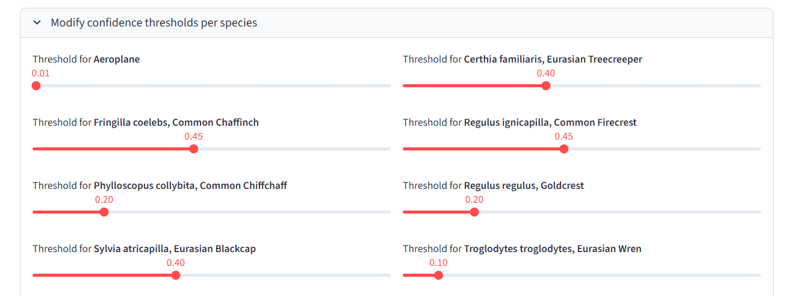
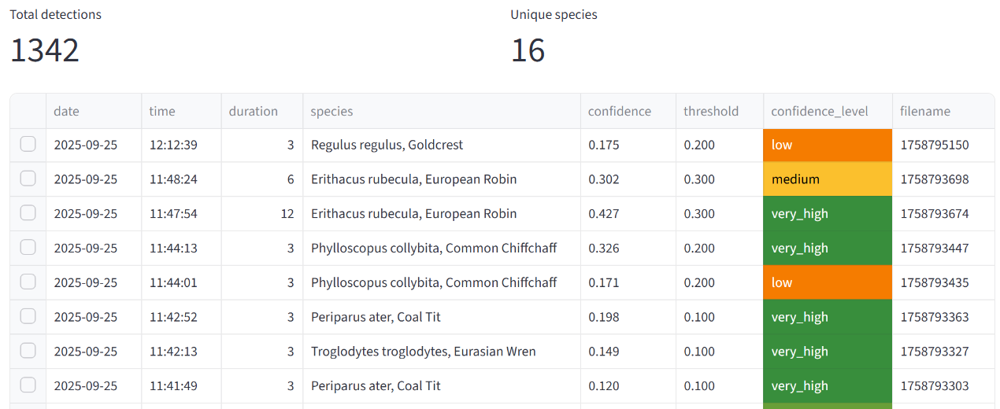
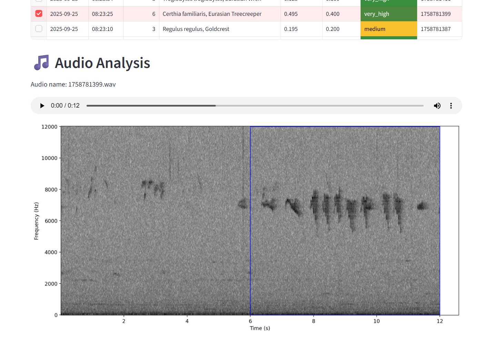

# ECO-AID: Raspberry Pi & Monitoring Framework Setup Guide

**Project:** ECO-AID: Bridging Ecoacoustics, Artificial Intelligence, and Satellite Networks to Monitor Biodiversity in Remote Areas  
**Authors:** Alberto Testolin and Giacomo Schiavo  
**Date:** October 21, 2026  

---

This document describes in detail the procedure for setting up and configuring Raspberry Pi devices to run the ecoacoustic monitoring framework developed for the ECO-AID project.

---

## Table of Contents
1. [Hardware Assembly and Software Configuration](#1-hardware-assembly-and-software-configuration)
   - [1.1 Required Components](#11-required-components)
   - [1.2 Assembly and Configuration Steps](#12-assembly-and-configuration-steps)
2. [Dashboard Overview](#2-dashboard-overview)
   - [2.1 Purpose](#21-purpose)
   - [2.2 Features](#22-features)
   - [2.3 How It Works](#23-how-it-works)
   - [2.4 Running the Dashboard](#24-running-the-dashboard)
   - [2.5 Configuration](#25-configuration)
   - [2.6 Interface Overview](#26-interface-overview)
3. [Appendix A - Systemd Service Configuration](#appendix-a---systemd-service-configuration)

---

## 1. Hardware Assembly and Software Configuration

### 1.1 Required Components
* **Single Board Computer:** Raspberry Pi 3 or 4 (Model B)
* **Audio HAT:** HiFiBerry DAC+ ADC Pro
* **Storage:** MicroSD card (32GB or larger recommended)
* **Microphone:** XVive LV2 Lavalier Microphone (or equivalent)
* **Power Supply:** 5V, 3A USB-C power adapter
* **Enclosure:** Weatherproof enclosure (for field deployment)
* **Workstation:** Personal computer for remote management and monitoring

---

### 1.2 Assembly and Configuration Steps

#### Step 1: System Setup
1. Flash **Raspberry Pi OS** onto the microSD card using [Raspberry Pi Imager](https://www.raspberrypi.com/software/) (*Raspberry Pi OS Lite* is recommended for headless operation).
2. Configure **SSH access** for remote management.
3. For network connectivity, configure Wi-Fi access according to standard Raspberry Pi setup guidelines.
4. Mount the **HiFiBerry DAC+ ADC Pro** HAT securely onto the Raspberry Pi GPIO headers.

---

#### Step 2: Microphone Hardware Setup
1. Connect the lavalier microphone to the 3.5mm jack input on the HiFiBerry board.
2. Enable microphone bias voltage by closing **both bias jumpers** (item **#5** in the pinout diagram below). Locate the two-pin headers on the left and right sides of the 3.5mm audio jack and place jumper blocks across them.

More details in the [official documentation of the DAC + ADC Pro](https://www.hifiberry.com/docs/data-sheets/datasheet-dac-adc-pro/)




##### HiFiBerry Board Layout Reference
| Item # | Description |
| :--- | :--- |
| **1** | Analog input (3.5mm stereo jack) |
| **2** | Analog output (RCA connectors) |
| **3** | Analog output (P5 pin header) |
| **4** | I2S data interface (factory/development use only) |
| **5** | **Microphone bias jumpers** (close both headers to supply microphone bias voltage) |
| **6** | Analog input |

---

#### Step 3: Virtual Environment Setup
Open a terminal session on the Raspberry Pi and execute the following commands:

```bash
# Navigate to user home directory
cd /home/<user>

# Create Python virtual environment
python3 -m venv venv

# Activate virtual environment
source venv/bin/activate

# Upgrade pip
pip install --upgrade pip
```

##### (Optional) Disable Onboard Bluetooth to Conserve Power
To lower power consumption during field deployment, disable onboard Bluetooth:

```bash
sudo nano /boot/firmware/config.txt
```

Add the following line at the end of the file:
```ini
dtoverlay=disable-bt
```

---

#### Step 4: BirdNET Installation
1. Clone the **BirdNET-Analyzer (v1.5.1)** repository onto the Raspberry Pi:
   ```bash
   git clone https://github.com/kahst/BirdNET-Analyzer.git
   cd BirdNET-Analyzer
   ```
2. Install Python dependencies inside your virtual environment:
   ```bash
   pip install -r requirements.txt
   ```

---

#### Step 5: Bird Detection Backend Setup
1. Clone the `bird_detection_backend` repository:
   ```bash
   git clone https://github.com/7alberto/BirdNet-RaspberryBackend.git
   cd bird_detection_backend
   pip install -r requirements.txt
   ```
2. Create a folder named `custom_classifier` within the backend directory and place your trained custom model files inside:
   ```text
   bird_detection_backend/
   └── custom_classifier/
       ├── model.tflite
       └── model_Labels.txt
   ```
3. Set up `systemd` background services so `live_birdnet.py` and `server.py` start automatically on boot (refer to [Appendix A](#appendix-a---systemd-service-configuration)).

---

#### Step 6: Bird Detection Monitor Setup (Local PC)
1. On your monitoring computer, clone the `bird_detection_monitor` repository:
   ```bash
   git clone https://github.com/your-org/bird_detection_monitor.git
   cd bird_detection_monitor
   pip install -r requirements.txt
   ```
2. Open `config.py` and set the `RASPBERRY_IP` variable to match your Raspberry Pi's IP address:
   ```python
   RASPBERRY_IP = "192.168.X.X"
   ```

---

## 2. Dashboard Overview

### 2.1 Purpose
The dashboard provides a real-time visual UI for monitoring system health and BirdNET predictions generated by the deployed Raspberry Pi unit. It enables users to verify active recording sessions, track hardware metrics, and review audio detections in real time.

---

### 2.2 Features
* **System Metrics Monitoring:** Real-time metrics including CPU usage, RAM utilization, storage status, CPU temperature, and audio recording status.
* **Live Detections Table:** Real-time log of bird species predictions complete with timestamps, species names, and confidence scores.
* **Interactive Spectrogram Viewer:** Click on any detection record to inspect its audio spectrogram with a highlighted region highlighting the specific detection window.
* **Filterable Time Window:** Flexible display parameters (e.g., last 30s, 1m, 5m).

---

### 2.3 How It Works

```text
  [ Lavalier Microphone ]
             │
             ▼
  [ Raspberry Pi (BirdNET Live Script) ]
             │
             ▼
  [ Backend Server (API / WebSocket) ]
             │
             ▼
  [ Streamlit Dashboard Interface ]
```

1. The Raspberry Pi continuously records audio via the HiFiBerry HAT and processes audio blocks through BirdNET.
2. System hardware stats (CPU, RAM, temperature) are collected continuously and served over the backend REST/WebSocket API.
3. The dashboard UI fetches metrics and detection records, displaying live updates.
4. When a user selects a detection row, the backend extracts the corresponding audio snippet and generates an annotated spectrogram.

---

### 2.4 Running the Dashboard

Launch the dashboard application using Streamlit:

```bash
streamlit run app.py
```

---

### 2.5 Configuration Parameters (`config.py`)

| Parameter | Description |
| :--- | :--- |
| `RASPBERRY_IP` | IP address of the target Raspberry Pi device |
| `API_BASE` | Base URL of the backend API service |
| `REFRESH_RATE` | Dashboard update refresh interval in milliseconds (e.g., `15000` = 15 seconds) |
| `AUDIO_CACHE_DIR` | Local directory used for caching downloaded audio files for spectrograms |
| `CUSTOM_THRESHOLDS_PATH` | Path to CSV file containing species-specific confidence thresholds |
| `DEFAULT_THRESHOLD_VALUE` | Default detection threshold when no custom species threshold is present |
| `REQUEST_TIMEOUT` | Timeout limit (in seconds) for HTTP API requests |
| `CACHE_TTL_DETECTIONS` | Cache time-to-live (seconds) for detection data |
| `CACHE_TTL_METRICS` | Cache time-to-live (seconds) for hardware system metrics |
| `NON_SPECIES_PREFIXES` | Class prefixes used to filter out environmental non-species noise (wind, insects, etc.) |

---

### 2.6 Interface Overview

#### Overview Page
Provides an overview of current unit operations and real-time detection logs.



#### Sidebar Section
Displays real-time hardware health metrics (Recording state, CPU %, RAM %, Disk %, and Temperature). Allows configuring maximum display table rows, toggling non-species filters, refreshing state, and clearing audio cache.



#### Date & Confidence Filtering
Filter detection events by date range and confidence band tags (`low`, `medium`, `high`, `very_high`).



#### Species Threshold Adjustment
Fine-tune confidence classification thresholds dynamically per bird species.



#### Detections Table
Comprehensive log detailing timestamps, call duration, species classification, raw confidence values, assigned thresholds, and audio filename references.



#### Spectrogram and Audio Player
Select any entry in the detection table to trigger audio playback and inspect the spectrogram visual representation. The target acoustic event is enclosed within a highlighted blue box.



---

## Appendix A - Systemd Service Configuration

To ensure background scripts automatically execute on system startup and recover from errors, configure standard systemd services on the Raspberry Pi.

### 1. Live BirdNET Detection Service

Create the service unit file:
```bash
sudo nano /etc/systemd/system/live_birdnet.service
```

Paste the following content:
```ini
[Unit]
Description=BirdNet Live Detection Service
After=network.target

[Service]
Type=simple
User=<user>
WorkingDirectory=/home/<user>
ExecStart=/home/<user>/venv/bin/python /path/to/live_birdnet.py
Restart=always
RestartSec=60

[Install]
WantedBy=multi-user.target
```

---

### 2. Dashboard Server Service

Create the server unit file:
```bash
sudo nano /etc/systemd/system/server.service
```

Paste the following content:
```ini
[Unit]
Description=BirdNet Dashboard Server
After=network.target

[Service]
Type=simple
User=<user>
WorkingDirectory=/home/<user>
ExecStart=/home/<user>/venv/bin/python /path/to/server.py
Restart=always
RestartSec=60

[Install]
WantedBy=multi-user.target
```

---

### 3. Service Activation Commands

Reload the systemd manager, enable services on boot, and start them immediately:

```bash
# Reload systemd configuration
sudo systemctl daemon-reload

# Enable auto-start on boot
sudo systemctl enable live_birdnet.service
sudo systemctl enable server.service

# Start services
sudo systemctl start live_birdnet.service
sudo systemctl start server.service

# Check service status
sudo systemctl status live_birdnet.service
sudo systemctl status server.service
```
